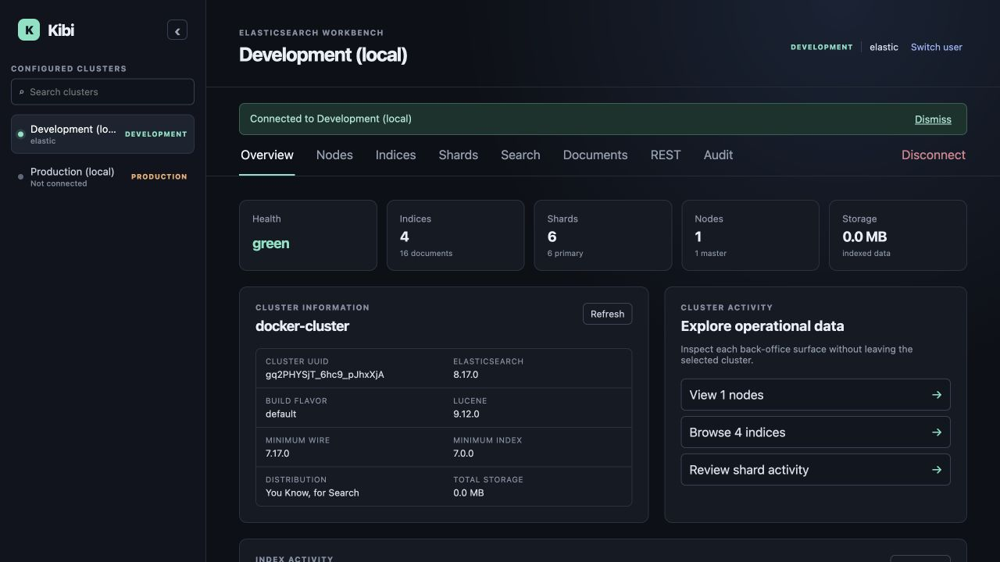
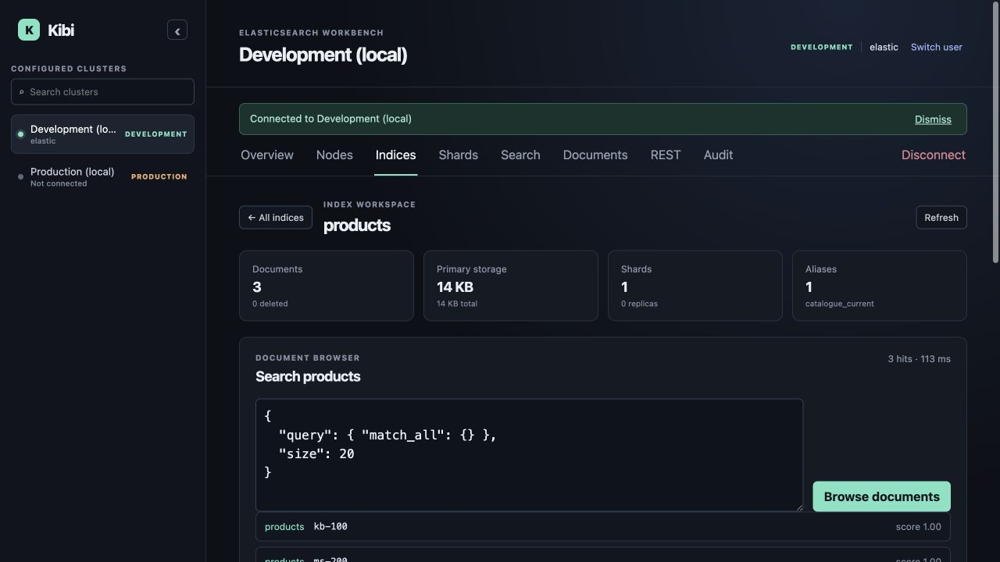
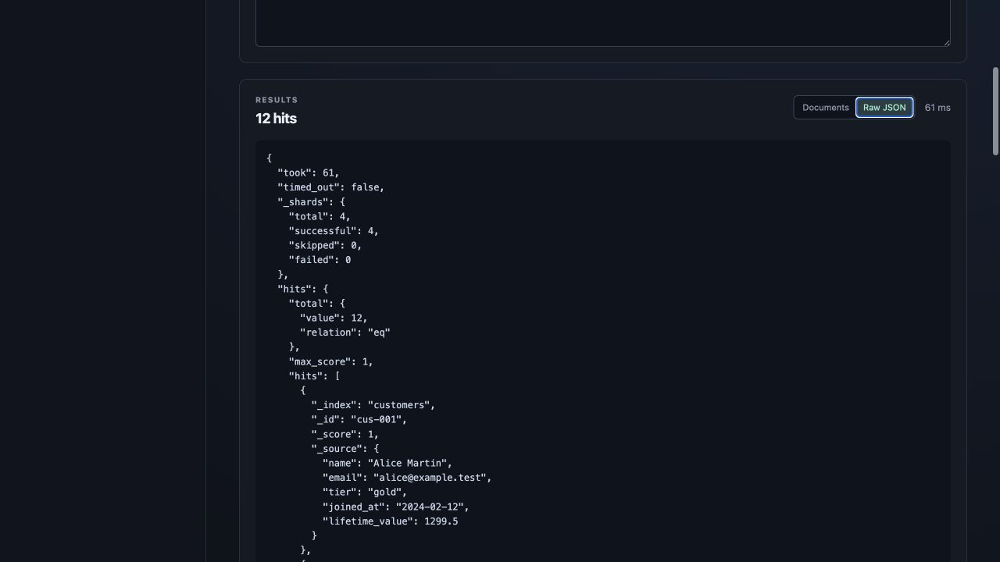
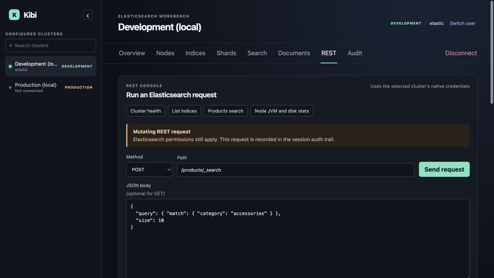

# Kibi

**A lightweight, multi-cluster Elasticsearch workbench.**

Kibi is for teams that use Elasticsearch as part of their product and want a
fast operational interface without deploying a full Kibana instance beside
every cluster. Run one Kibi server, register the clusters it can reach, and
move between them from a single focused UI.

Kibi deliberately keeps authentication native: each person connects to a
cluster with that cluster's Elasticsearch username/password or API key.
Elasticsearch remains the authority for permissions, and Kibi keeps the
credential only in its server-side session.

## What you can do

- Work across many Elasticsearch 8+ clusters from one Kibi deployment.
- Sign in per cluster using native Basic authentication or an Elasticsearch API
  key.
- See cluster health, compatibility details, node roles and resource pressure.
- Inspect indices, mappings, settings, aliases, document counts, and storage.
- Follow primary and replica shards in a node placement map, including
  recovery and unassigned state.
- Run Query DSL searches with readable expandable documents or the raw
  Elasticsearch response.
- Use a REST console with searchable operational recipes, browser-local history
  and favourites, and production confirmation for mutating calls.
- Create, replace, partially update, or delete individual documents from an
  index workspace, again with a production guardrail.

Kibi is intentionally not an identity provider and does not replace
Elasticsearch security. It is a focused back-office interface for the APIs
your search-engineering team already uses.

## Screenshots

### Cluster overview

One workbench surfaces health, index and shard counts, connected user,
Elasticsearch compatibility details, and quick paths into operational views.



### Index workspace

Open an index to inspect its mapping, settings, aliases, statistics, and
documents with a scoped Query DSL browser.



### Search response, your way

Search results can be read as expandable documents or switched to the complete
Elasticsearch JSON response when debugging needs the exact payload.



### REST console

Run a JSON Elasticsearch request against the selected cluster with native
credentials and production safeguards.



## Use it locally

Prerequisites: Docker, Go 1.22+, and Node.js 20+.

```sh
make up       # starts local development and production Elasticsearch 8 clusters
make api      # starts Kibi's Go API on http://localhost:8080
make web      # starts the Vite UI on http://localhost:5173
```

Open [http://localhost:5173](http://localhost:5173), select **Development
(local)**, and sign in with `elastic` / `changeme-dev`. The development
environment is seeded with a small catalog, customer, order, and support-ticket
dataset so every view has meaningful data. The bundled production cluster is
kept empty and uses `elastic` / `changeme-prod`.

To restore the local sample data after the cluster is already running:

```sh
make seed
```

To stop the local Elasticsearch services:

```sh
make down
```

`make build` compiles both applications. On some macOS Go installations, the
external linker used by the Makefile avoids a system-loader issue.

## Connect remote clusters

Kibi's API server must have network access to every registered Elasticsearch
endpoint, normally through a private network or VPN. Give the server its
catalogue through `KIBI_CLUSTERS`:

```sh
export KIBI_CLUSTERS='[
  {
    "id": "search-production",
    "name": "Search production",
    "endpoint": "https://es-prod.example.internal:9200",
    "environment": "production"
  },
  {
    "id": "search-staging",
    "name": "Search staging",
    "endpoint": "https://es-staging.example.internal:9200",
    "environment": "development"
  }
]'
make api
```

Use [config/clusters.example.json](config/clusters.example.json) as a complete
starting shape. Users choose a cluster and authenticate directly against it;
their access in Kibi is therefore constrained by the Elasticsearch roles,
users, and API keys you already manage.

For a shared deployment, host the API and compiled frontend behind your normal
internal ingress. Set `KIBI_COOKIE_SECURE=true` when serving HTTPS. Kibi's
session storage is currently memory-only, so credentials disappear when the API
process restarts and deployments should use a single API instance until shared
session storage is introduced.

## Technology

- Go standard library HTTP API and Elasticsearch REST proxy
- React + TypeScript + Vite frontend
- Elasticsearch 8.x for the local demo environment
- Docker Compose for local infrastructure

## Repository layout

```text
backend/     Go API and its tests
frontend/    React workbench
config/      Deployable cluster-catalogue examples
dev/         Local-only Elasticsearch demo tooling
docs/        Product direction and screenshots
```

Development notes and longer-term direction live in
[docs/product-direction.md](docs/product-direction.md).

## Website

The public product website lives in [website](website/). It is a zero-build
static site ready for Cloudflare Pages; see [website/README.md](website/README.md)
for the Git-connected deployment settings.
