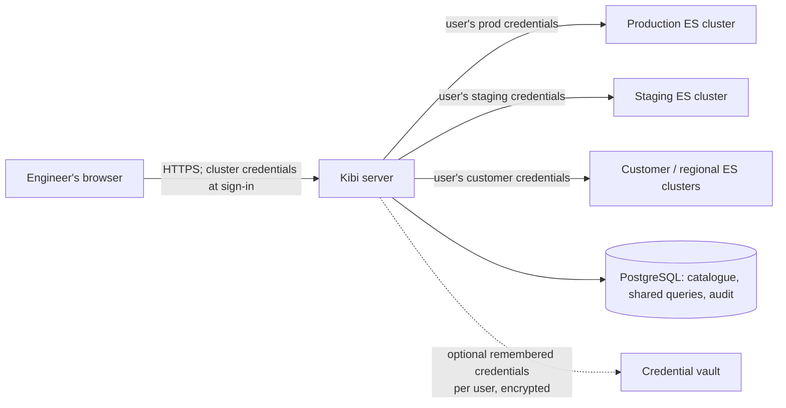

# Kibi — product and technical direction

**Status:** proposal

**Working name:** Kibi

## 1. Product in one sentence

Kibi is a fast, focused workbench for teams that operate Elasticsearch as a
search datastore: one local app or one shared deployment can securely connect
to many Elasticsearch clusters, making documents, mappings, queries, and
operational data easy to inspect without the weight of Kibana.

## 2. Why this exists

Kibana is an excellent broad Elastic platform, but it brings dashboards,
observability, security administration, alerting, ingest, and other capabilities
that search-centric product teams may not need. Running it per cluster also
becomes operationally awkward when an organisation owns dozens or hundreds of
clusters.

Elasticvue validates the value of a compact Elasticsearch GUI: it supports
cluster overview, index/alias/shard management, document search and editing,
REST queries, and snapshot/repository management. It is distributed as a
desktop app, browser extension, web app, self-hosted app, and Docker image.
Its web and self-hosted modes connect directly from the browser, which requires
Elasticsearch CORS configuration; its Docker configuration can seed a list of
clusters. Kibi should preserve the approachable day-to-day workflow while
solving shared, governed access across many clusters. [Elasticvue README](https://github.com/cars10/elasticvue)

## 3. Product principles

1. **Search-engine-first.** Optimise for finding and understanding application
   data, schemas, and query behaviour; do not try to recreate the whole Elastic
   platform.
2. **Multi-cluster by design.** A user can discover, switch, search, and
   compare configured clusters from one place.
3. **Light to run.** One small container/binary plus a database is the shared
   deployment target. A desktop mode should work without a server.
4. **Secure defaults.** Cluster credentials are submitted only at explicit
   per-cluster sign-in over HTTPS, live only for the active session by default,
   and are never logged or returned to the browser. Every sensitive action is
   confirmed and recorded.
5. **Fast for real data.** Server-side pagination, bounded requests,
   cancellation, and virtualised result lists are requirements, not polish.
6. **Useful without training.** The primary workflow should be understandable
   to an engineer who already knows an index name and a JSON query.
7. **No proprietary lock-in.** Support Elastic-compatible distributions through
   documented capability detection rather than branding assumptions.

## 4. Target users and jobs

| User | Core job | What success looks like |
| --- | --- | --- |
| Application engineer | Diagnose why a search result is missing or wrong | Reach the document, mapping, and query explanation in minutes |
| Search/relevance engineer | Iterate on a query and compare behaviour | Saved, shareable query tests with stable inputs and readable output |
| Platform/SRE engineer | Provide controlled access to many clusters | One deployment, centrally governed access, auditable changes |
| Support/operations teammate | Investigate a known customer or record | A safe read-only path that does not require shell access or Kibana expertise |

The initial buyer/administrator is a platform or search team. The daily user is
an engineer investigating production data.

## 5. Scope boundaries

### Kibi should do

- Support Elasticsearch 8.x and newer. Older Elasticsearch versions and
  OpenSearch are explicitly out of scope for the initial release.
- Browse clusters, indices, aliases, mappings, settings, templates, and health.
- Search and inspect documents with Elasticsearch Query DSL and a guided query
  builder for common filters.
- Explain query behaviour where the connected cluster supports it.
- Create, update, and delete individual documents with clear safeguards.
- Provide a powerful REST console for supported Elasticsearch APIs.
- Organise connections and saved queries across many clusters.
- Make support and debugging workflows shareable and auditable.

### Kibi should not do in v1

- Compete with Kibana dashboards, Lens, Canvas, APM, Logs, SIEM, alerting, or
  Fleet.
- Operate cluster infrastructure: node scaling, upgrades, ILM authoring, or
  deployment orchestration.
- Become a general SQL/BI tool.
- Proxy arbitrary internet URLs; it is an Elasticsearch-focused gateway.
- Store or index copies of customer documents.

## 6. Feature map

### 6.1 Foundation: connections and access (MVP)

- **Cluster catalogue:** named clusters, environment labels (development,
  staging, production), team ownership, tags, health state, and last-seen
  metadata. Design and test this for hundreds of clusters; it is not a
  node-monitoring system.
- **Connection types:** HTTPS endpoint and native Elasticsearch username/password
  authentication first. API keys are the next connector; mTLS and AWS SigV4
  follow only when a concrete user need exists.
- **Per-cluster sign-in:** when a user opens a cluster, they authenticate to
  that cluster with their own Elasticsearch basic credentials or API key. The
  cluster's existing users and roles decide every read and write permission.
- **Session handling:** credentials are held only for the active Kibi session,
  in server memory, by default. “Remember this cluster” is an explicit opt-in
  that stores a per-user credential encrypted at rest; passwords, tokens, and
  API keys are always redacted from APIs, logs, exports, and audit records.
- **Safe proxy defaults:** Kibi adds request timeouts, response-size limits, and
  destructive-action confirmations, but it does not duplicate or override an
  Elasticsearch cluster's access-control decisions.
- **Local mode:** connections and secrets live only in the OS credential store;
  no Kibi account or central database is required.

### 6.2 Cluster explorer (MVP)

- Cluster landing page: version/distribution, health, node and shard summary,
  index count, storage, and quick warnings.
- Index and alias browser with filtering, sortable size/document/shard columns,
  mappings, settings, and field capabilities.
- Index detail view: alias relationships, sample documents, and mapping
  explorer.
- Dedicated read-only views for cluster information, index information, and
  shard information; each also exposes its exact Elasticsearch API request.
- Explicit compatibility/capability banner for unsupported APIs or versions.

### 6.3 Document search workbench (MVP)

- Index or alias selection with index-pattern support.
- JSON Query DSL editor with syntax validation, formatting, autocomplete for
  fields, keyboard run/cancel controls, and query timing.
- Guided filters for common `term`, `match`, `range`, `exists`, and boolean
  conditions; switching modes must preserve the raw DSL.
- Result table with virtual scrolling, selectable columns, pinned identifiers,
  sort, pagination/search-after, and JSON document inspector.
- Field-aware highlighting and a clear display of `_index`, `_id`, `_score`,
  routing, and sort values.
- Inspect and copy the exact request and response; offer a one-click handoff to
  the REST console.
- Explain/profile request, when the current Elasticsearch user is allowed and
  the cluster supports it.
- Search history stored per user, with opt-in persistence for potentially
  sensitive query values.

### 6.4 Document mutation (MVP, including production, guarded)

- Create, replace, partial update, and delete a single document.
- Compare before/after JSON before applying a change.
- Allow production mutations at launch when the user's Elasticsearch role
  permits them. Require a typed confirmation and clear production environment
  label for every production update or delete.
- Respect Elasticsearch optimistic concurrency (`if_seq_no` and
  `if_primary_term`) to prevent accidental overwrites.
- Show the Elasticsearch username (when known), cluster, index, document ID,
  timestamp, request summary, result, and correlation ID in Kibi's audit trail.

### 6.5 REST console (MVP)

- Method/path/body editor, request history, cURL import/export, response viewer,
  formatting, and cancellation.
- Elasticsearch enforces endpoint permissions using the current cluster
  credentials. Kibi can apply optional cluster-level guardrails, such as hiding
  destructive APIs or requiring an administrator enablement flag.
- Hardened request limits: timeout, maximum response bytes, pagination guard,
  and prohibition on cluster-wide destructive wildcard calls unless separately
  approved.
- Treat the API families most useful to back-office users as first-class,
  discoverable console recipes: document `GET`/`POST`/`PUT`/`DELETE`, `_search`,
  cluster information, index information, aliases, mappings, settings, and
  shard information. The REST console remains the escape hatch for everything
  else the current Elasticsearch user is permitted to do.

### 6.6 Collaboration (v1)

- Saved queries grouped into personal and shared collections.
- Share links that contain a query reference, not connection credentials or
  document payloads. The recipient must sign in to the target cluster and their
  own Elasticsearch permissions always apply.
- A lightweight query review format: description, sample inputs, expected
  outcome, and tags.
- Export query definitions as versionable JSON/YAML files.

### 6.7 Admin and fleet operations (v1)

- Add, test, disable, and rotate cluster connections.
- Bulk import/export cluster metadata **without secret values**.
- Connection health checks, per-cluster sign-in status, and a clear disconnect
  action that removes active credentials from the server session.
- Configurable throttles, active-session visibility, and audit-log export.
- A fleet overview that deliberately presents small, actionable cluster cards,
  optimised for hundreds of clusters, not a node-monitoring dashboard product.

### 6.8 Later, only after the core is excellent

- Relevance test cases and regression comparison across indices/clusters.
- Synonym and analyzer playground.
- Cross-cluster result comparison for migration validation.
- Snapshot browsing and restore assistance (permission-gated).
- Schema-diff views for templates and mappings.
- A read-only embeddable support view.

## 7. Authentication and permission model

### Primary model: authenticate separately to each Elasticsearch cluster

Kibi is a connection directory and secure proxy, not an identity provider. A
central Kibi instance remembers approved cluster addresses and labels. When a
user selects one, Kibi asks for that cluster's Elasticsearch credentials and
passes them through for subsequent requests. The browser talks only to Kibi,
which removes the need to configure browser CORS on every Elasticsearch
cluster.

Elasticsearch remains the source of truth for identity and authorisation:

| Action | Enforced by |
| --- | --- |
| User authentication | Selected Elasticsearch cluster |
| Index, document, and API permissions | Selected Elasticsearch cluster |
| Which cluster is selected | User chooses from Kibi's configured catalogue |
| Request duration/response bounds and confirmation UX | Kibi |
| Kibi shared-query and application-administration access | Kibi, only if those features are enabled |

This means a user can be an editor in staging and read-only in production with
no duplicated users, groups, or roles in Kibi. Kibi must not make a request that
is authorised with a central, more-privileged service credential on the user's
behalf.

### Optional later layer: Kibi application SSO and catalogue policy

An organisation may later put OIDC in front of Kibi to protect the Kibi app,
govern access to the cluster catalogue, or manage shared queries. This is
separate from Elasticsearch data access: the user still signs in to each
cluster, and Elasticsearch still decides what data they may access. It should
not be required for self-hosted or initial shared-server deployments.

## 8. Deployment model

### A. Local desktop application

Best for a developer connecting to accessible clusters with their own
credentials. The desktop app sends requests directly to Elasticsearch, avoids
browser CORS constraints, and stores settings/secrets locally. It does not
provide central sharing or an organisation audit log.

### B. Shared multi-cluster server — recommended for teams

One Kibi deployment provides a browser UI, cluster catalogue, and an
Elasticsearch-aware outbound proxy. It can reach any configured cluster over the
organisation private network or VPN. Browsers never need direct network access
to Elasticsearch and no cluster needs a CORS exception for Kibi. The user signs
in separately to each selected cluster; Kibi forwards that user's credentials
rather than a shared all-powerful service account. Agents and reverse tunnels
for isolated networks are out of scope for launch.



Active per-cluster credentials are session state and should be memory-only by
default. Multiple Kibi replicas can be added later with a compatible encrypted
session store or session affinity; request streaming and cancellation remain
end-to-end. Elasticsearch remains the source of truth for both document data
and data-access permissions.

### C. Single-user local server

The same container can run on `localhost` with local authentication disabled and
an encrypted local database. This is useful for users who prefer a web UI but
do not want a desktop wrapper.

## 9. Recommended technology choices

| Area | Recommendation | Why |
| --- | --- | --- |
| Web UI | React + TypeScript + Vite | Large ecosystem, fast iteration, and strong editor/table libraries |
| UI primitives | Tailwind CSS + Radix primitives | Small, accessible, composable design system without a heavy component framework |
| Data fetching | TanStack Query | Caching, cancellation, request state, and invalidation are important to a data workbench |
| Editor | CodeMirror 6 | Mature JSON editing, extensions, and keyboard support without Monaco's weight |
| Tables | TanStack Table + a virtualiser | Enables large result sets without rendering thousands of rows |
| Shared API | Go | Small static binaries, simple concurrency and streaming proxying, excellent operational profile |
| Elasticsearch client | Official Go Elasticsearch client, with a narrow internal interface | Current API support while keeping feature code testable and version-aware |
| Metadata DB | PostgreSQL | Reliable concurrent cluster catalogue, audit, and shared-query storage |
| Schema/data access | `sqlc` + versioned SQL migrations | Keeps queries explicit and avoids runtime ORM surprises |
| Cluster authentication | Elasticsearch basic auth and API keys first | Preserves each cluster's native identities, roles, and authorisation model |
| Kibi identity | Optional OIDC/OAuth 2.0, later | Useful for protecting the Kibi app and collaboration—not required for ES access |
| Credentials | Memory-only session by default; opt-in AES-GCM credential vault | Does not persist a user's ES secret unless they explicitly choose convenience |
| Observability | OpenTelemetry + structured JSON logs | Trace a Kibi request without logging query bodies or credentials by default |
| Desktop wrapper | Tauri 2, after web/server MVP | Reuses the UI and creates a much lighter local app than Electron |
| Packaging | Multi-stage Docker image and signed Tauri bundles | One simple shared-server artifact and one native local artifact |

This intentionally differs from Elasticvue's current Vue/Quasar/Vite frontend
and Tauri desktop application. Kibi's recommended server architecture adds a
secure proxy and a durable multi-cluster catalogue while preserving every
cluster's own authentication and authorisation model. The UI framework is
reversible early, while the proxy, credential-handling rules, and API boundaries
are product-defining. [Elasticvue package manifest](https://github.com/cars10/elasticvue/blob/master/package.json)

### Architecture rules

- The browser calls only Kibi. It submits a cluster credential only over HTTPS
  at cluster sign-in; Kibi never returns it to the browser after that.
- Every outbound request has a resolved cluster ID, the active per-cluster
  Elasticsearch credential, timeout, byte limit, and audit correlation ID.
- Kibi does not persist active credentials by default and must provide an
  immediate disconnect action that removes them from the server session.
- Use a narrow Kibi API for common workflows, plus a constrained REST tunnel;
  do not expose a generic open proxy.
- Cache metadata briefly and per cluster; do not cache document search responses
  by default.
- Perform capability detection at connection time and use it to hide or explain
  unsupported features.
- Build a fake Elasticsearch HTTP test server into integration tests; run a
  small set of compatibility tests against supported Elasticsearch versions in
  CI.

## 10. Design direction

The interface should feel like a polished engineering tool: dense but calm,
fast, and legible. It should not mimic Kibana's navigation or attempt to make
every Elasticsearch API a first-level page.

### Information architecture

```text
Cluster switcher (searchable; environment colour + health)
└── Cluster home
    ├── Explore
    │   ├── Indices & aliases
    │   ├── Index detail
    │   └── Mappings
    ├── Search workbench
    ├── REST console
    ├── Saved queries
    └── Administration (permission-gated)
        ├── Connections
        ├── Access policies
        └── Audit log
```

### Search-workbench layout

```text
┌──────────────────────────────────────────────────────────────────────┐
│ Cluster: prod-eu-west  /  Index: products-v3       [Run] [Cancel]    │
├─────────────── Query & filters ────────────────┬──── Document ───────┤
│ JSON DSL editor                                │ selected JSON       │
│ guided filters / validation / elapsed time      │ metadata / diff      │
├──────────────────── Results ───────────────────┤                      │
│ field selector · sort · 10,000+ hits · 84 ms    │                      │
│ virtualised, resizable table                    │                      │
└────────────────────────────────────────────────┴──────────────────────┘
```

### Visual language

- Use a neutral dark and light theme; reserve colour for environment and
  health/status, never as the sole warning signal.
- Make production unmistakable with a persistent amber/red environment label,
  not an alarming full-screen theme.
- Use a readable monospace face for data and code, and a clean sans-serif for
  navigation and controls.
- Prefer progressive disclosure: useful summaries first, raw API payloads one
  click away.
- Optimise keyboard flow: `⌘/Ctrl+K` opens cluster/query navigation,
  `⌘/Ctrl+Enter` runs a query, and destructive actions are intentionally slower.
- Support narrow screens for inspection, but target desktop as the primary
  search and editing environment.

## 11. MVP release definition

Kibi v0.1 is ready when a team can deploy one instance, add two or more
clusters, and safely complete the following end-to-end:

1. Sign in to an allowed cluster with an Elasticsearch username/password,
   without configuring browser CORS.
2. Find an index/alias and inspect its mappings and settings.
3. Run, save, reopen, and share a Query DSL search.
4. Inspect a result document and its raw request/response.
5. Update or delete one production document, when permitted, with a typed
   confirmation and optimistic-concurrency protection.
6. Attempt a production mutation without the required Elasticsearch permission
   and see it denied by Elasticsearch.
7. Locate the successful and denied actions in an audit log.
8. Use dedicated views or REST-console recipes for documents, `_search`,
   cluster/index/shard information, mappings, settings, and aliases.

### Explicit MVP exclusions

No dashboards, alerting, snapshots, bulk write UI, index lifecycle management,
AWS SigV4, desktop app, or cross-cluster comparison. These are valuable only
after the shared server proves its core workflow.

## 12. Delivery plan

| Phase | Outcome | Key deliverables |
| --- | --- | --- |
| 0 — Validation (1–2 weeks) | Confirm the narrow problem | Five user interviews; collect ten real diagnostic tasks and anonymised query examples; wireframe-test the workbench |
| 1 — Vertical slice (2–3 weeks) | Prove the architecture | One ES 8 cluster, native-user login, proxy, cluster home, read-only search, audit event |
| 2 — MVP (4–6 weeks) | Useful for a small internal team | Hundreds-ready multi-cluster catalogue, explorer, saved queries, back-office API recipes, guarded production document mutation |
| 3 — Hardening (3–4 weeks) | Safe production adoption | Session and credential-vault security review, rate/request limits, backup/restore config, observability, version matrix |
| 4 — Local and workflow depth | Broaden adoption | Tauri desktop app, import/export, query review, relevance tooling based on feedback |

The durations are planning ranges for a focused small team, not commitments.
Prioritisation after phase 1 should be based on observed usage, especially which
REST calls are common enough to deserve dedicated screens.

## 13. Risks and decisions to make early

| Decision / risk | Recommended direction |
| --- | --- |
| Shared vs per-user ES identity | Use per-user, per-cluster Elasticsearch credentials as the default. Do not add a shared service credential to the request path unless a future, explicit use case requires it. |
| Elasticsearch/OpenSearch support | Support Elasticsearch 8.x and newer at launch. Older Elasticsearch versions and OpenSearch are out of scope until a later explicit compatibility decision. |
| Credentials in shared-server mode | Keep credentials memory-only for the active session. Make encrypted “remember this cluster” storage opt-in and independently review its threat model. |
| Credentials in local mode | Store in OS keychain only; document that a local user is responsible for endpoint/network access. |
| Query bodies can contain sensitive data | Redact by default in logs/audit; make history persistence configurable by organisation policy. |
| Large/expensive queries | Enforce time, byte, aggregation, and pagination limits; show the user what limit stopped a request. |
| Feature creep | Every proposed feature must answer: does it materially improve search-data investigation or multi-cluster governance? If not, integrate or defer. |
| Naming | Verify trademark and historical product-name conflicts before public release; use “Kibi” only as a working name until then. |

## 14. Confirmed launch decisions and remaining discovery

### Confirmed

- **Elasticsearch support:** Elasticsearch 8.x and newer.
- **Data mutation:** production single-document create, update, and delete are
  launch features, guarded by Elasticsearch permissions, typed confirmation,
  optimistic concurrency, and audit records.
- **First authentication method:** native Elasticsearch users with username and
  password.
- **Fleet scale:** a catalogue of hundreds of clusters, not thousands of nodes.
- **Network model:** the Kibi server has direct private-network or VPN
  reachability to every configured Elasticsearch endpoint. Agents and reverse
  tunnels are not launch features.
- **Metadata visibility:** index names and mappings may be visible even when a
  user cannot read documents, as determined by that cluster's Elasticsearch
  permissions.
- **Back-office workflow:** document access/mutation, `_search`, cluster/index/
  shard information, aliases, mappings, and settings are launch-priority APIs.

### Remaining discovery

1. How often do cluster addresses and catalogue metadata change?
2. Which concrete native-user authentication configurations must be tested—for
   example, Elasticsearch's file realm, native realm, or a reverse proxy in
   front of Elasticsearch?

## 15. Immediate next actions

1. Conduct the phase-0 interviews using the questions above and turn ten real
   tasks into acceptance scenarios.
2. Confirm the first Elasticsearch authentication methods and the cluster
   network model; these determine the server's security boundary.
3. Produce a clickable workbench prototype with the cluster switcher, Query DSL
   editor, results table, and document inspector.
4. Build the phase-1 vertical slice against a disposable Elasticsearch cluster
   before committing to advanced management features.
